# Design: refactor-frmmain

## 1. Resumen Técnico

Descomposición de `FrmMain.cs` (4503 LOC) en 8 servicios especializados + 2 UserControls, reduciendo el formulario a presentación pura (~900–1500 LOC). La estrategia es **extracción incremental por fase**: cada fase mueve un grupo cohesivo de métodos a un servicio con interfaz, lo registra en DI, e inyecta el servicio en `FrmMain` para delegar. La Fase 4 es el punto de inflexión: activa `UseGameLoopCoordinator = true` y reemplaza `EmptyGameLoopTickProcessor` por `HandProcessor` (que implementa `IGameLoopTickProcessor`), consolidando el pipeline captura → OCR → decisión dentro del `GameLoopCoordinator` existente.

**Principio rector**: paridad funcional estricta. Ningún cambio observable. Cada servicio nuevo es un movimiento mecánico de código desde `FrmMain` sin alterar lógica.

## 2. Arquitectura Target

```
┌─────────────────────────────────────────────────────────────────┐
│                         FrmMain (UI)                            │
│  - Event handlers (clicks, load, closing)                       │
│  - Composición: delega a servicios inyectados                   │
│  - UserControls embebidos (HistorialTab, BankrollTab, etc.)     │
└──────────┬──────────┬──────────┬──────────┬────────────────────┘
           │          │          │          │
     ┌─────▼───┐ ┌────▼────┐ ┌──▼───┐ ┌───▼──────────┐
     │Detection│ │Capture  │ │Table │ │HandProcessor │
     │LoopSvc  │ │Service  │ │Read  │ │(IGameLoopTick│
     │         │ │         │ │Svc   │ │  Processor)  │
     └────┬────┘ └────┬────┘ └──┬───┘ └───┬──────────┘
          │           │         │          │
          │           │         │    ┌─────▼──────────────┐
          │           │         │    │GameLoopCoordinator │
          │           │         │    │(existing, unchanged│
          │           │         │    │ interface)         │
          │           │         │    └─────┬──────────────┘
          │           │         │          │
     ┌────▼───┐ ┌────▼────┐ ┌──▼───┐ ┌───▼──────────┐
     │ColorDet│ │GetWindow│ │OCR   │ │PokerCalc,    │
     │Service │ │ScreenUC │ │Svc   │ │GameCoord,    │
     │(exist) │ │(exist)  │ │(exis)│ │PostflopSvc   │
     └────────┘ └─────────┘ └──────┘ └──────────────┘

     ┌──────────────┐  ┌──────────────┐  ┌──────────────┐
     │UiUpdateSvc   │  │ThemeService  │  │RegionEditor  │
     │(amplía       │  │              │  │Control       │
     │IUiSyncSvc)   │  │              │  │(UserControl) │
     └──────────────┘  └──────────────┘  └──────────────┘
```

## 3. Decisiones de Diseño (ADRs)

### ADR-1: Reemplazar BackgroundWorker por Task.Run + eventos

| Opción | Tradeoff | Decisión |
|--------|----------|----------|
| Mantener BackgroundWorker | Cero riesgo, pero ancla el loop a WinForms | ❌ Rechazada |
| Task.Run + CancellationToken + eventos | +testable, -pierde ReportProgress/Cancellation nativo | ✅ **Elegida** |
| IHostedService + BackgroundService | Más idiomático en .NET hosting, pero requiere Host lifecycle | ❌ Overkill para loop controlado por UI |

**Rationale**: `BackgroundWorker` fuerza `this.Invoke()` para cualquier lógica post-detección. `Task.Run` con `CancellationTokenSource` permite cancelación limpia, y los eventos `HeroTurnDetected` / `FlopDetected` / `DetectionStopped` desacoplan el detector de la UI. El `this.Invoke()` provisional de Fase 1 se elimina en Fase 5 cuando `UiUpdateService` absorba el marshaling.

**Mitigación**: `CancellationTokenSource` reemplaza `e.Cancel`. Las métricas (`TotalChecks`, `Detections`, `Errors`) se mueven a un `DetectionMetrics` record interno del servicio.

### ADR-2: Feature flag progresivo (UseGameLoopCoordinator)

| Opción | Tradeoff | Decisión |
|--------|----------|----------|
| Cutover directo en Fase 4 | Simple, pero sin rollback | ❌ Rechazada |
| Feature flag con resolución condicional en DI | +rollback instantáneo, -ligera complejidad en registro | ✅ **Elegida** |

**Rationale**: La feature flag `Features.UseGameLoopCoordinator` ya existe. En Fase 4, el registro DI de `IGameLoopTickProcessor` se resuelve condicionalmente: si la flag es `true`, se registra `HandProcessor`; si es `false`, se mantiene `EmptyGameLoopTickProcessor`. El `GameLoopCoordinator` no cambia — solo recibe un `IGameLoopTickProcessor` distinto.

**Implementación**: Factory delegate en `Program.cs`:
```csharp
services.AddSingleton<IGameLoopTickProcessor>(sp =>
{
    var flags = sp.GetRequiredService<IOptions<FeatureFlags>>().Value;
    return flags.UseGameLoopCoordinator
        ? sp.GetRequiredService<HandProcessor>()
        : EmptyGameLoopTickProcessor.Instance;
});
```

### ADR-3: PlayerGameState — acceso secuencial, no thread-safe

| Opción | Tradeoff | Decisión |
|--------|----------|----------|
| Hacer PlayerGameState thread-safe (locks) | +seguro, -overhead en cada acceso | ❌ Rechazada |
| Acceso secuencial garantizado por el pipeline | +simple, -requiere disciplina | ✅ **Elegida** |

**Rationale**: Hoy `_playerGameState` se modifica desde `btnCapture_Click` (UI thread) y se lee desde `UpdateUIWithResults` (UI thread). Con `HandProcessor` en Fase 4, las modificaciones ocurren dentro de `ExecuteAsync` (thread del pool), pero **siempre secuencialmente**: un tick a la vez (garantizado por `_tickLock` en `GameLoopCoordinator`). `UiUpdateService` recibe el `GameLoopResult` inmutable (record), no accede a `_playerGameState` directamente.

**Regla**: `PlayerGameState` NUNCA se expone fuera del pipeline. `GameLoopResult` contiene solo los datos necesarios para UI (snapshot inmutable).

### ADR-4: GameLoopResult expandido para pipeline completo

| Campo nuevo | Tipo | Propósito |
|-------------|------|-----------|
| `PotOdds` | `decimal?` | Pot odds calculadas |
| `Equity` | `double?` | Equity calculado |
| `HoleCards` | `(string, string)?` | Cartas del héroe |
| `BoardCards` | `IReadOnlyList<string>` | Cartas comunitarias |
| `PlayerBets` | `IReadOnlyDictionary<string, decimal>` | Apuestas por jugador |
| `HeroPosition` | `TablePosition?` | Posición del héroe |
| `HandSituation` | `HandSituation?` | Situación de mano |
| `ResponseAction` | `string?` | Acción recomendada (texto) |
| `TableName` | `string?` | Nombre de la mesa |
| `SummaryText` | `string?` | Texto de resumen para tbResume |

**Rationale**: `UiUpdateService` necesita todos estos datos para actualizar la UI sin acceder a estado compartido. `GameLoopResult` se convierte en el único contrato entre el pipeline de decisión y la UI.

### ADR-5: Service lifetimes

| Servicio | Lifetime | Rationale |
|----------|----------|-----------|
| `IDetectionLoopService` | Singleton | Loop de fondo, una instancia por app |
| `ICaptureService` | Scoped | Depende de `_handle` y `_session` por sesión |
| `ITableReaderService` | Scoped | Usa `ICaptureService` + OCR por sesión |
| `HandProcessor` | Scoped | Pipeline completo por sesión (reemplaza EmptyGameLoopTickProcessor) |
| `IUiUpdateService` | Scoped | Se attacha/detacha con la sesión de UI |
| `IThemeService` | Singleton | Puro styling, sin estado |
| `RegionEditorControl` | Transient | UserControl, uno por instancia de FrmMain |

### ADR-6: UI marshaling — eventos + ISynchronizeInvoke

| Opción | Tradeoff | Decisión |
|--------|----------|----------|
| `this.Invoke()` en cada servicio | Simple, pero acopla servicios a WinForms | ❌ Solo para UiUpdateService |
| Eventos C# + subscriber hace Invoke | +desacoplado, -más boilerplate | ✅ **Elegida para DetectionLoopService** |
| `SynchronizationContext.Post` | Moderno, pero menos control | ❌ No necesario |

**Rationale**: `DetectionLoopService` emite eventos (`HeroTurnDetected`, `FlopDetected`). `FrmMain` (o `UiUpdateService` en Fase 5) se suscribe y hace el marshal al UI thread. Los servicios de negocio (`HandProcessor`, `TableReaderService`) nunca tocan `Control` ni `ISynchronizeInvoke`.

## 4. Contratos de Interfaces

```csharp
// === Fase 1: DetectionLoopService ===
public interface IDetectionLoopService
{
    event EventHandler<HeroTurnDetectedEventArgs>? HeroTurnDetected;
    event EventHandler<FlopDetectedEventArgs>? FlopDetected;
    event EventHandler? DetectionStopped;

    bool IsRunning { get; }
    Task StartAsync(IntPtr windowHandle, CancellationToken cancellationToken);
    Task StopAsync();
}

public sealed record HeroTurnDetectedEventArgs(
    Color ActionColor,
    GameState CurrentState,
    DateTimeOffset Timestamp);

public sealed record FlopDetectedEventArgs(
    Color FlopColor,
    DateTimeOffset Timestamp);

// === Fase 2: CaptureService ===
public interface ICaptureService
{
    Bitmap? CaptureWindow(IntPtr handle);
    Domain.ValueObjects.Region GetScaledRegion(Domain.ValueObjects.Region region);
    void SaveReferenceDimensions(int width, int height);
    string? GetJsonValue(string section, string key);
}

// === Fase 3: TableReaderService ===
public interface ITableReaderService
{
    Task SetBetPlayerAsync(Bitmap screenshot, PlayerGameState state);
    Task SetHeroStackAsync(Bitmap screenshot, PlayerGameState state);
    Task SetPotValueAsync(Bitmap screenshot, PlayerGameState state);
    Task<(string HandNumber, bool IsNewHand)> SetTableHandAsync(Bitmap screenshot);
    Task ObtainCardsPlayerAsync(Bitmap screenshot, PlayerGameState state);
    bool IsBoardCardVisible(Bitmap screenshot, string cardRegionName);
    int CountVisibleBoardCards(Bitmap screenshot);
}

// === Fase 4: HandProcessor (implements IGameLoopTickProcessor) ===
// No new interface — uses existing IGameLoopTickProcessor.ExecuteAsync
// HandProcessor se registra como IGameLoopTickProcessor cuando flag = true

// === Fase 5: UiUpdateService (amplía IUiSyncService) ===
public interface IUiUpdateService
{
    void UpdateResults(GameLoopResult result, Control syncTarget);
    void UpdateOverlay(GameLoopResult result, IFrmOverlay overlay);
    void UpdateSummaryText(GameLoopResult result, TextBox summaryBox);
    void UpdatePlayerIndicators(GameLoopResult result, /* controles */);
    void UpdateCardImages(GameLoopResult result, /* controles */);
}

// === Fase 6: ThemeService ===
public interface IThemeService
{
    void InitializeVisualStyles(Form form);
    void ApplyModernTabStyle(TabControl tabControl);
    void ApplyGameTabStyle(TabPage page);
    void ApplyConfigTabStyle(TabPage page);
}

// === Fase 7-8: UserControls (no interfaz, heredan UserControl) ===
// HistorialTabControl, BankrollTabControl, MetricsTabControl, RegionEditorControl
```

## 5. Diagrama de Dependencias

```mermaid
graph TD
    FrmMain --> IDetectionLoopService
    FrmMain --> ICaptureService
    FrmMain --> ITableReaderService
    FrmMain --> IGameLoopCoordinator
    FrmMain --> IUiSyncService
    FrmMain --> IUiUpdateService
    FrmMain --> IThemeService
    FrmMain --> IGameCoordinator
    FrmMain --> ITableLayoutService

    HandProcessor --> ICaptureService
    HandProcessor --> ITableReaderService
    HandProcessor --> GameLoopStateMachine
    HandProcessor --> IGameCoordinator
    HandProcessor --> IPokerCalculator
    HandProcessor --> IPostflopContextHolder

    GameLoopCoordinator --> IGameLoopTickProcessor
    IGameLoopTickProcessor -.->|flag=false| EmptyGameLoopTickProcessor
    IGameLoopTickProcessor -.->|flag=true| HandProcessor

    DetectionLoopService --> GetWindowsScreenUseCase
    DetectionLoopService --> RegionLookupCache
    DetectionLoopService --> GameLoopStateMachine
    DetectionLoopService --> ColorDetectionService
    DetectionLoopService --> DetectionLoggerService

    CaptureService --> GetWindowsScreenUseCase
    CaptureService --> ICoordinateScaler

    TableReaderService --> ICaptureService
    TableReaderService --> IScreenReaderService
    TableReaderService --> OcrService
    TableReaderService --> ImageCropperService
    TableReaderService --> CardCacheService

    UiSyncService --> IGameLoopCoordinator
    UiUpdateService --> IActionFormatter
    UiUpdateService --> IOverlayPositioner
```



## 6. Fases de Implementación Detalladas

### Fase 1: DetectionLoopService (~280 LOC extraídos)

**Archivos a crear**:
- `src/OpenScrape.App/Services/DetectionLoopService.cs` — implementación
- `src/OpenScrape.App/Services/IDetectionLoopService.cs` — interfaz
- `test/OpenScrape.App.Tests/DetectionLoopServiceTests.cs` — tests unitarios

**Archivos a modificar**:
- `src/OpenScrape.App/Forms/FrmMain.cs` — eliminar `BackgroundWorker1_DoWork`, `PerformEnhancedDetection`, `ReadPixelFromBuffer`, `DetectionResult` record. Inyectar `IDetectionLoopService`. Suscribirse a eventos.
- `src/OpenScrape.App/Program.cs` — registrar `IDetectionLoopService` → `DetectionLoopService` (Singleton)

**Cambios en FrmMain**:
- Eliminar campo `backgroundWorker1` y su handler
- En `btnWindow_Click`: reemplazar `backgroundWorker1.RunWorkerAsync()` por `_detectionLoopService.StartAsync(_handle, cts.Token)`
- Suscribirse a `HeroTurnDetected` → invocar `btnCapture_Click` (vía `this.Invoke`)
- Suscribirse a `FlopDetected` → transicionar `_gameLoopStateMachine`
- `DetectionResult` y `PerformEnhancedDetection` se mueven al servicio

### Fase 2: CaptureService (~160 LOC extraídos)

**Archivos a crear**:
- `src/OpenScrape.App/Services/CaptureService.cs`
- `src/OpenScrape.App/Services/ICaptureService.cs`
- `test/OpenScrape.App.Tests/CaptureServiceTests.cs`

**Archivos a modificar**:
- `src/OpenScrape.App/Forms/FrmMain.cs` — eliminar `GetImageWhilePlaying`, `SaveReferenceDimensionsToConfig`, `GetScaledRegion`, `GetJsonValue`. Delegar en `ICaptureService`.
- `src/OpenScrape.App/Program.cs` — registrar `ICaptureService` → `CaptureService` (Scoped)

**Cambios en FrmMain**:
- `GetImageWhilePlaying()` → `_captureService.CaptureWindow(_handle)`
- `GetScaledRegion()` → `_captureService.GetScaledRegion()`
- `SaveReferenceDimensionsToConfig()` → `_captureService.SaveReferenceDimensions()`

### Fase 3: TableReaderService (~380 LOC extraídos)

**Archivos a crear**:
- `src/OpenScrape.App/Services/TableReaderService.cs`
- `src/OpenScrape.App/Services/ITableReaderService.cs`
- `test/OpenScrape.App.Tests/TableReaderServiceTests.cs`

**Archivos a modificar**:
- `src/OpenScrape.App/Forms/FrmMain.cs` — eliminar `SetBetPlayer`, `SetHeroStack`, `SetPotValue`, `SetTableHand`, `ObtainCardsPlayerAsync`, `IsBoardCardVisible`, `CountVisibleBoardCards`, `DetectNewHand`. Delegar en `ITableReaderService`.
- `src/OpenScrape.App/Program.cs` — registrar `ITableReaderService` → `TableReaderService` (Scoped)

**Dependencias del servicio**: `ICaptureService`, `IScreenReaderService`, `OcrService`, `ImageCropperService`, `CardCacheService`, `RegionLookupCache`, `GameLoopStateMachine`, `ICoordinateScaler`

### Fase 4: HandProcessor + Feature Flag (~480 LOC extraídos)

**Archivos a crear**:
- `src/OpenScrape.App/Services/HandProcessor.cs` — implementa `IGameLoopTickProcessor`
- `test/OpenScrape.App.Tests/HandProcessorTests.cs`

**Archivos a modificar**:
- `src/OpenScrape.App/Forms/FrmMain.cs` — eliminar `ProcessTableInfoAsync`, `ProcessPreflopAsync`, `SetPreflopAggressors`, `ProcessPostFlopAsync`, `ProcessFlopAsync`, `ProcessTurnAsync`, `ProcessRiverAsync`, `HandleNewHandAsync`, `GetPreflopHeroPosition`. `btnCapture_Click` se simplifica drásticamente (o se elimina si el GameLoopCoordinator lo reemplaza).
- `src/OpenScrape.App/Program.cs` — factory delegate para `IGameLoopTickProcessor` condicional en feature flag
- `src/OpenScrape.App/Services/GameLoopResult.cs` — añadir campos (PotOdds, Equity, HoleCards, BoardCards, etc.)

**Cutover**: Al activar `UseGameLoopCoordinator = true`, `btnCapture_Click` deja de ser el entry point. El `GameLoopCoordinator` llama `HandProcessor.ExecuteAsync()` en cada tick. El resultado (`GameLoopResult`) se emite vía `ResultReady` → `UiSyncService`/`UiUpdateService`.

### Fase 5: UiUpdateService (~230 LOC extraídos)

**Archivos a crear**:
- `src/OpenScrape.App/Services/UiUpdateService.cs` — amplía responsabilidades de `UiSyncService`
- `src/OpenScrape.App/Services/IUiUpdateService.cs`
- `test/OpenScrape.App.Tests/UiUpdateServiceTests.cs` (ampliar existentes)

**Archivos a modificar**:
- `src/OpenScrape.App/Forms/FrmMain.cs` — eliminar `UpdateUIWithResults`, `UpdateOverlayWithPotOdds`, `UpdateResumeTextForPreflop`, `UpdateResumeTextForFlop`, `UpdatePlayerIndicators`, `UpdateCardImages`, `GetCardImage`
- `src/OpenScrape.App/Services/UiSyncService.cs` — integrar con `IUiUpdateService` o delegar
- `src/OpenScrape.App/Program.cs` — registrar `IUiUpdateService`

### Fase 6: ThemeService (~350 LOC extraídos)

**Archivos a crear**:
- `src/OpenScrape.App/Services/ThemeService.cs`
- `src/OpenScrape.App/Services/IThemeService.cs`
- `test/OpenScrape.App.Tests/ThemeServiceTests.cs`

**Archivos a modificar**:
- `src/OpenScrape.App/Forms/FrmMain.cs` — eliminar `InitializeVisualStyles`, `ApplyModernTabStyle`, `ApplyGameTabStyle`, `ApplyConfigTabStyle`, etc.
- `src/OpenScrape.App/Program.cs` — registrar `IThemeService` (Singleton)

**Riesgo**: BAJO. Código de styling puro, sin lógica de negocio.

### Fase 7: TabPageContributions (~360 LOC extraídos)

**Archivos a crear**:
- `src/OpenScrape.App/Forms/Controls/HistorialTabControl.cs` : UserControl
- `src/OpenScrape.App/Forms/Controls/BankrollTabControl.cs` : UserControl
- `src/OpenScrape.App/Forms/Controls/MetricsTabControl.cs` : UserControl

**Archivos a modificar**:
- `src/OpenScrape.App/Forms/FrmMain.cs` — eliminar `InitializeHistorialTab`, `InitializeBankrollTab`, `InitializeMetricsTab` y sus handlers. Embeber UserControls en tabs.

### Fase 8: RegionEditor (~580 LOC extraídos)

**Archivos a crear**:
- `src/OpenScrape.App/Forms/Controls/RegionEditorControl.cs` : UserControl
- `test/OpenScrape.App.Tests/RegionEditorControlTests.cs`

**Archivos a modificar**:
- `src/OpenScrape.App/Forms/FrmMain.cs` — eliminar `LoadTreeViewRegions`, `UpdateRegionDisplay`, `btnTestColor_Click`, `btnTestTexto_Click`, `btnTestCarta_Click`, `btnSaveMap_Click`, handlers de TreeView. Reemplazar con `RegionEditorControl` embebido.

## 7. Estrategia de Testing

| Fase | Unit Tests | Integration Tests | Mock Strategy |
|------|-----------|-------------------|---------------|
| 1: DetectionLoopService | Detección con bitmap sintético (colores conocidos), cancelación, overlay no visible | — | `GetWindowsScreenUseCase` mock con bitmap de colores fijos; `RegionLookupCache` mock |
| 2: CaptureService | Captura con handle válido/inválido, escalado de coordenadas | — | `GetWindowsScreenUseCase` mock; `ICoordinateScaler` mock |
| 3: TableReaderService | Lectura OCR con strings conocidos, detección de nueva mano, reintentos | — | `IScreenReaderService` mock; `OcrService` mock; `ICaptureService` mock |
| 4: HandProcessor | Pipeline preflop/postflop completo, feature flag on/off, cancelación | HandProcessor → GameLoopCoordinator → resultado | `ICaptureService`, `ITableReaderService`, `IPokerCalculator`, `IGameCoordinator` mocks |
| 5: UiUpdateService | Actualización de controles con `GameLoopResult` sintético, resultado vacío | — | `IFrmOverlay` mock; controles WinForms reales en test |
| 6: ThemeService | Verificación de colores/fuentes aplicados | — | Controles WinForms reales en test |
| 7: TabPageContributions | Estado se preserva entre cambios de tab | — | UserControls instanciados en test |
| 8: RegionEditor | Test de color/OCR/carta con datos sintéticos | — | `IScreenReaderService`, `OcrService` mocks |

**Regla transversal**: Los 1163 tests existentes DEBEN permanecer verdes tras cada fase. Se ejecuta `dotnet test` al final de cada fase como gate.

**Paridad**: Al completar Fase 4, se verifica manualmente en sesión real de casino que el bot se comporta idénticamente con `UseGameLoopCoordinator = true` vs `false`.

## 8. Open Questions

- [ ] `GameLoopResult` necesita transportar el snapshot completo de `PlayerGameState` para que `UiUpdateService` pueda renderizar `UpdatePlayerIndicators` sin acceder a estado compartido. ¿Se incluye un `PlayerStateSnapshot` record inmutable, o se pasan campos individuales?
- [ ] `btnCapture_Click` en Fase 4: ¿se elimina completamente (reemplazado por `GameLoopCoordinator` loop) o se conserva como entry point manual para modo test?
- [ ] `RegionEditorControl` necesita `PictureBox` con screenshot de la ventana de póker. ¿Recibe la imagen por propiedad (seteada por `FrmMain`) o llama a `ICaptureService` internamente?
